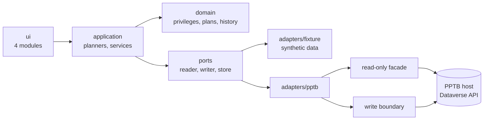

# Architecture

A static React 18 + TypeScript app (one classic IIFE bundle, no backend) that runs in the PPTB webview and talks to Dataverse only through the host's `window.dataverseAPI`. The host owns sign-in and tokens; the tool never sees them.

## Layers and data flow
- **domain**: pure rules. Canonical depths `None|Basic|Local|Deep|Global`, privilege matrix, role-edit and move plans, operation history and restore rules. No I/O.
- **ports**: the interfaces the rest depends on (`securityDataReader`, `accessReader`, `securityDataWriter`, `operationStore`).
- **adapters**: `fixture` (synthetic data for tests and demo) and `pptb` (the real host). Display labels exist only in `ui`.
- **application**: use cases. Planners turn a request into an exact write plan; services run it and record the result.
- **ui**: Role Analyzer, Access Explorer, BU Manager and Operations in one shell; they share the connection, environment identity and history.

Read path: UI > application > reader port > read-only facade > host. Write path: UI preview > plan > confirmation > write boundary > host > independent read-back > history record.

## Write safety
1. **Read-only by construction.** The read adapter can reach only read methods of the host API, never with extra headers. A test fails if a mutating call appears outside `adapters/pptb/writer`.
2. **One write boundary.** A write is sent only if (a) the confirmation covers exactly that write, is unexpired and was given for this environment, (b) the environment is re-identified right now (URL, organization id and, when readable, environment id) and matches the confirmation, and (c) the host call is on the allow-list for that kind of write and names exactly the planned records.
3. **Fail closed.** Unreadable identity, unknown environment type, a changed connection or a stale plan leave writes off; Production or untyped environments need an explicit acknowledgement.
4. **Nothing assumed.** Every write is read back; a call that returned is only "not verified" until the read agrees. Partial results are reported as partial.
5. **Restore never forces.** A restore is planned from the recorded before/after states and refused when the current state differs.

## Key decisions
| Decision | Why |
|---|---|
| No hardcoded environment lock; identify the connection at run time | One tool for any environment; safety comes from identity checks and confirmation |
| History in the PPTB per-tool settings (latest 200, exportable) | No backend; the host provides storage |
| Host API only, primary connection only | No tokens in the tool; `minAPI` 1.2.7 |
| GPL-3.0-only | PPTB is GPL-3.0 |
