# User guide

Install: see the [README](../README.md#install). Open the tool from the PPTB sidebar; the header shows the connected environment and whether editing is enabled.

*The screenshots were taken in PPTB Desktop against a disposable Developer environment. The environment's name, address and identifiers, and the names of its users, are covered by dark boxes.*

## Before you change anything
- **Environment check.** The tool identifies the environment you are connected to. A Dev, Test or UAT connection allows editing at once. A **Production** or unknown-type connection stays read-only until you tick the acknowledgement in the header (for that environment only; switching connection asks again).
- **Preview, then confirm.** Every change shows exactly what will be sent. Nothing is written by selecting something.

  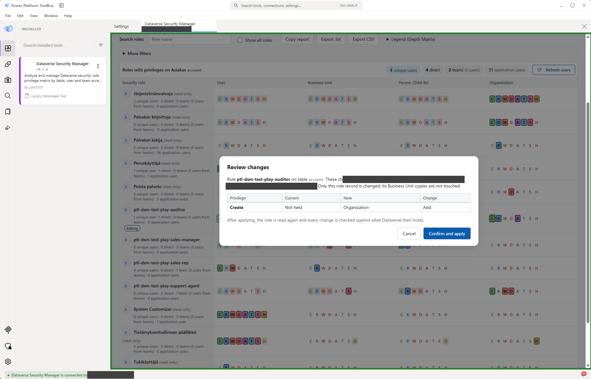

- **Results are read back.** Each step ends as *Verified*, *Failed* or *Uncertain*. Treat *Uncertain* as "check it": look at the target in Access Explorer (BU Manager results can read the users again).
- If the header says identification failed, use **Check again**. Editing stays off until it succeeds.

## Role Analyzer
**For:** answering "which roles grant what on this table" and changing a role's privileges.

1. Pick a table (search by display or logical name).
2. Read the matrix. *Privilege Matrix* shows the highest depth per privilege; *Depth Matrix* shows letters (C R W D A T S H) per depth: User, Business Unit, Parent: Child BU, Organization.
3. Filter by privilege, depth, holder or Business Unit. Press **Load users** to see how many people hold each role (direct, via team, application users); the **Refresh users** button reads again, up to 150 roles per click.
4. Open a role (chevron) for its details. To edit, click a depth in the matrix, then **Preview changes** > **Confirm and apply**.
5. To change several roles at once, click a depth in each role you want to change; the staged changes of every role are kept. **Preview changes** lists every role, and one confirmation applies them one after the other. Each role is checked by reading it again and is recorded as its own operation in **Operations**, so each can be restored separately. If a role does not end fully verified, the roles after it are not changed. Use **Remove** next to a role to drop it from the edit, or **Discard** to drop everything. All roles in one edit must be on the same table.

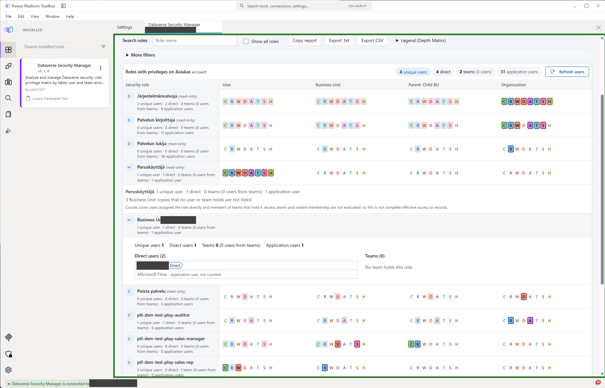

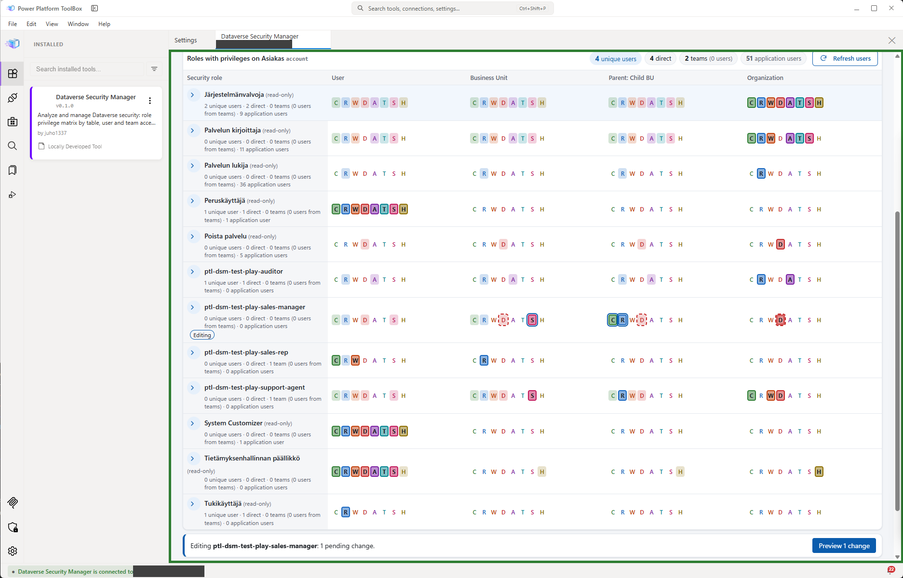

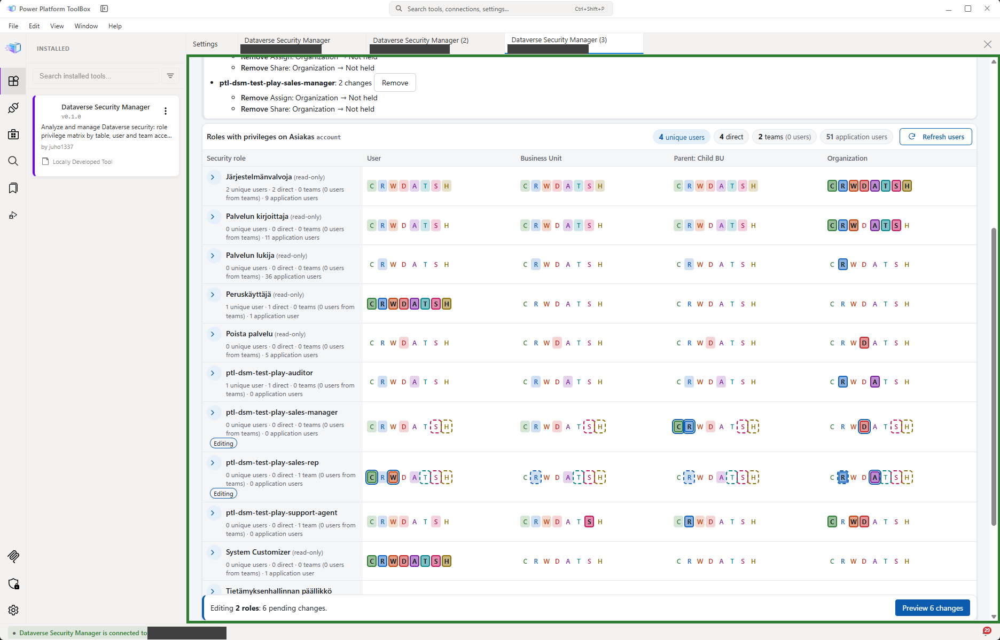

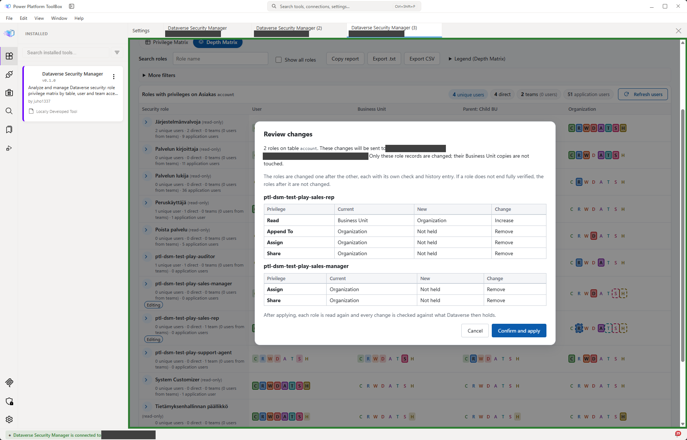

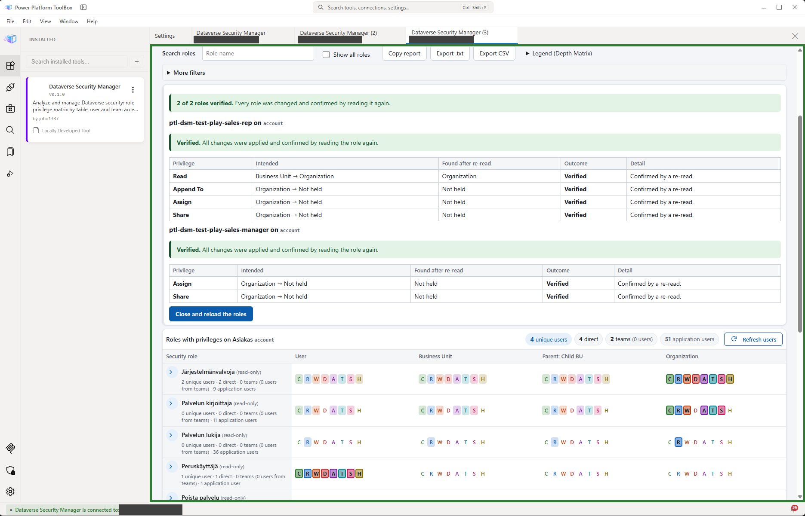

**Careful:** several roles can share a name in different Business Units; the tool shows which copy is meant. Counts are role assignments, not full effective access.

## Access Explorer
**For:** "what can this person or team do, and why".

1. Search users and teams (at least 2 characters); narrow by Business Unit if needed.
2. **Security roles** lists direct and team-derived roles. **Remove** appears only on direct roles; a team-derived role must be changed on the team.
3. **Add roles** opens a searchable picker (several at once); review the plan, then confirm.
4. **Table privileges** shows the highest granted depth per table and operation, and which role (direct or via team) provides it. Use **Copy report**, **Export .txt** or **Export CSV**.
5. **Compare with another user** shows the differences between two people.

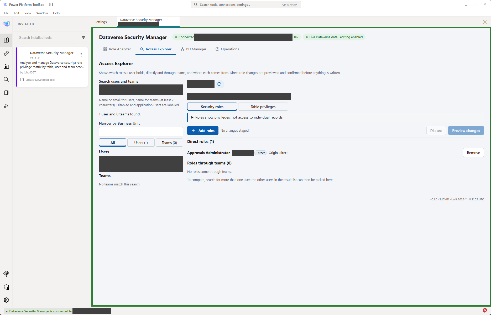

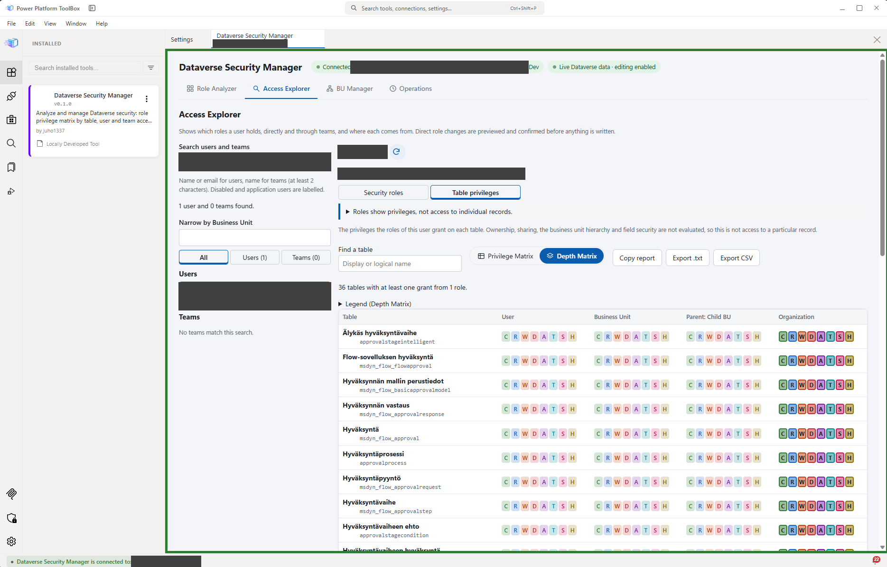

**Careful:** the privileges shown are what the roles grant. Record ownership, sharing, hierarchy and field security are not evaluated, so this is not access to a particular record.

## BU Manager
**For:** moving users to another Business Unit. Dataverse removes a user's direct roles on a move; the tool restores the equivalent roles of the target Business Unit.

Steps: **Select users** (search, or paste/import a list) > **Target BU** > **Role mapping** (recommended mapping; adjust per user) > **Review** (per-user dry run with warnings) > **Execute** (confirm; per-user results).

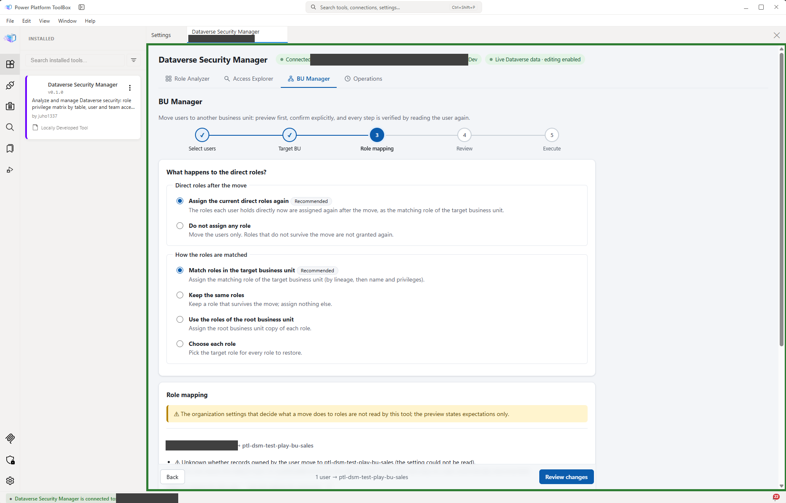

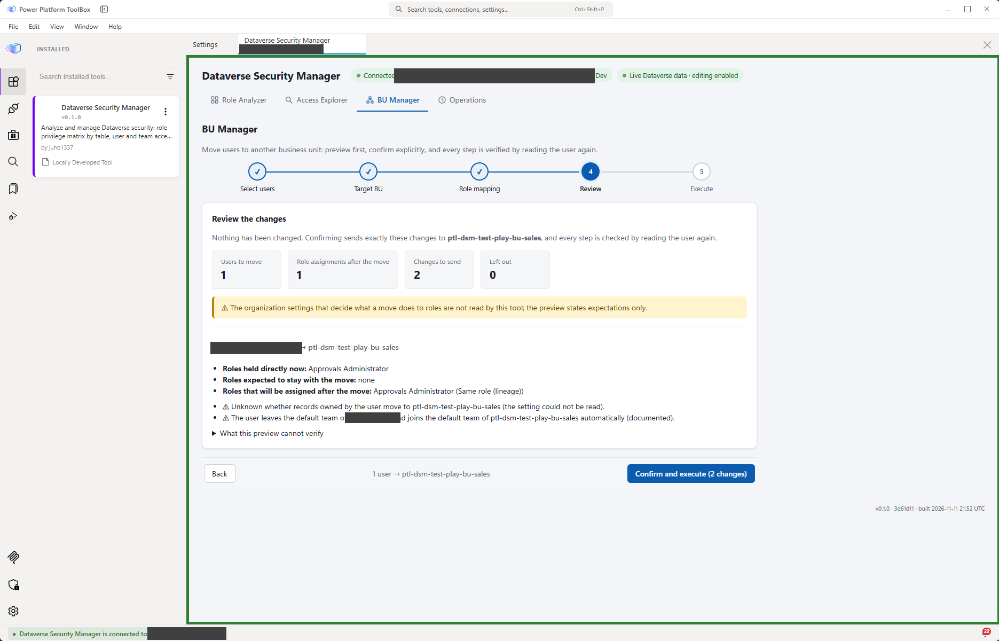

**Careful:** the plan is checked again at confirmation; if a user changed in the meantime, you are asked to review again. Bulk volume beyond a small group is untested.

## Operations
**For:** an audit trail and undo.

- Every change is listed with who, when, what and before/after. Select rows to **Copy as text** (paste into Jira or email), **Export .txt**, CSV or JSON.
- **Preview restore of selected operations** shows what would go back and what cannot. A restore is refused ("Cannot restore") when the target no longer is where the operation left it, when no before-state was recorded, or when it was already restored. Nothing is sent in those cases.
- History is kept in the tool's PPTB settings (latest 200 operations). Export it if you need a permanent copy.

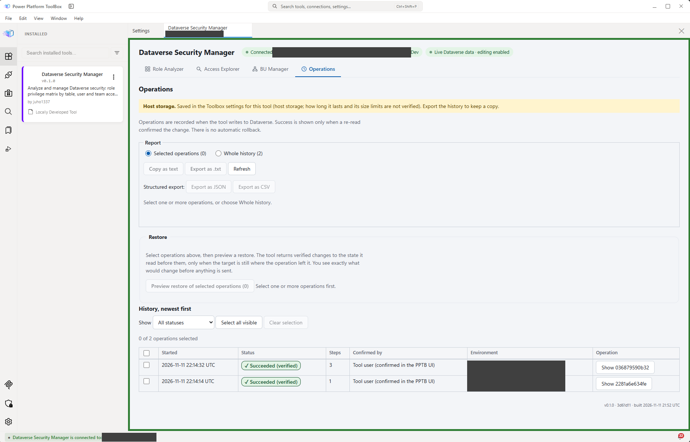

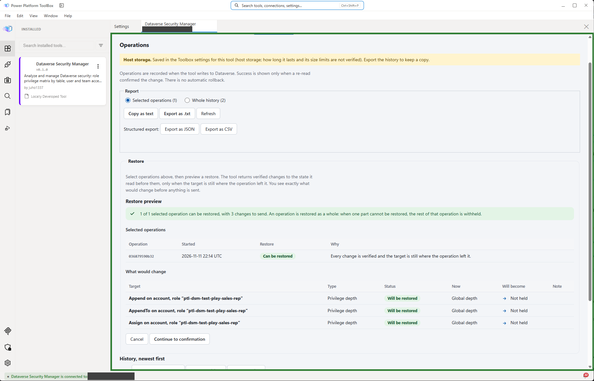

## Limits
- Only the PPTB primary connection is used. Hosts older than 1.2.7 are untested.
- A person with several saved connections may be refused (the tool needs exactly one candidate connection).
- No print/PDF export.
- Large Business Unit moves (beyond a small group) are untested.
- Access teams, nested membership and non-table privileges are not evaluated.
